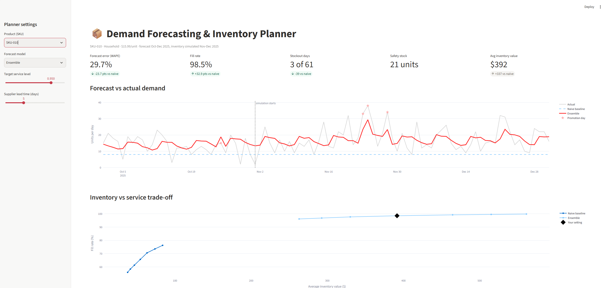

# Demand Forecasting → Inventory Policy

**Forecasting daily demand for a consumer-goods distribution center, then turning those forecasts into inventory decisions.**

Most forecasting projects stop at accuracy. This one asks the business question: *how much stock should we hold, and what does a better forecast save?*



## Results

**Forecast accuracy** (Oct–Dec 2025 holdout, 10 SKUs, models trained only on data through Sep 30, 2025):

| Model | WAPE | Bias |
|---|---:|---:|
| **Prophet** | **20.9%** | +1.8% |
| Ensemble (Prophet + LightGBM) | 21.0% | **−0.2%** |
| LightGBM | 22.3% | −2.3% |
| Naive (last value) | 27.5% | −8.0% |
| Same day last year | 31.3% | −4.4% |
| 28-day moving average | 31.6% | +6.4% |
| *Noise floor (perfect knowledge of true demand)* | *20.0%* | |

**Inventory impact** (daily-review order-up-to policy, 5-day lead time, simulated Nov–Dec 2025):

| Policy | Avg inventory | Fill rate | Stockout days |
|---|---:|---:|---:|
| Naive forecast @ 99% target | $3,886 | 93.1% | 114 |
| **Ensemble forecast @ 95% target** | **$3,960** | **99.0%** | **26** |
| Ensemble forecast @ 80% target | $2,741 | 96.8% | 75 |

- **24% lower forecast error** than the best baseline (WAPE 27.5% → 20.9%), within 1 point of the theoretical noise floor.
- **About the same inventory, far better service:** 99.0% vs 93.1% fill rate, with **77% fewer stockout days**.
- **Less inventory, still better service:** the ensemble beats the naive policy's best fill rate while holding **29% less inventory**.

## Key findings

- **Totals hide opposite seasons.** Beverages peak in summer while Household and Snacks peak in winter, so the total masks product-level patterns. That's why forecasting is done per SKU.
- **Moving averages lag at seasonal turns.** The 28-day average over-forecast by 6.4% heading into winter, because it only looks backward.
- **Slow movers are inherently harder.** Error rises from 18% (about 140 units/day) to 30% (about 16 units/day) even near the noise floor, so slow movers need proportionally more safety stock.
- **The simpler model won here.** Prophet beat LightGBM because the demand structure (trend × season × weekday × holidays × promotions) matches Prophet's design, and LightGBM had only about 21 months of usable training history. On larger, messier data, LightGBM often wins. Backtesting decides.
- **Seasonality-blind forecasts cause stockouts.** For SKU-010, a winter-peaking product, the naive policy filled only 65% of demand versus 98% for the ensemble.

## Approach

1. **Data:** synthetic daily sales for 10 SKUs over 3 years (2023–2025). The demand is built from trend, yearly seasonality, a weekday pattern, real US holiday dates, promotions (≈5% of days, +30–60% lift) and negative-binomial noise. A fixed seed makes it reproducible. Using synthetic data means the true demand is known, so model accuracy can be checked against the noise floor.
2. **Exploration:** seasonal and weekday indexes, promotion lift by SKU, holiday-window zooms.
3. **Forecasting:** four baselines, then Prophet (per-SKU, multiplicative, holiday calendar + promo regressor) and LightGBM (one global model with engineered features). All lag features use data **≥92 days old** to prevent leakage over the 92-day horizon.
4. **Inventory policy:** daily review, order-up-to level. Target = forecast over the lead time + safety stock, where safety stock = z·σ·√L. σ is measured on October forecast errors; the policy is then simulated day by day on November–December, a period it never saw, with lost sales.
5. **Dashboard:** a Streamlit app to choose a SKU, model, service level and lead time and see KPIs, the forecast and the cost-vs-service curve update live.

## Run it

```bash
git clone https://github.com/iabdullah42/demand-forecasting-inventory.git
cd demand-forecasting-inventory
pip install -r requirements.txt

python src/generate_data.py   # regenerate the data (optional, already included)
streamlit run app.py          # launch the dashboard
pytest                        # 8 tests
```

The notebooks in `notebooks/` walk through exploration (01), forecasting (02) and the inventory simulation (03).

## Project structure

```
app.py                  Streamlit dashboard
src/generate_data.py    synthetic demand generator
src/inventory.py        safety stock + day-by-day inventory simulation
notebooks/              01 explore · 02 forecasting · 03 inventory policy
data/raw/               generated sales history
data/processed/         forecasts and model scores
tests/                  data and inventory-logic tests
```

## Limitations and next steps

- Rolling-origin backtests across several quarters, instead of a single holdout.
- Probabilistic forecasts (quantiles) to set safety stock directly from the forecast distribution.
- Multi-echelon inventory (DC → stores), supplier MOQs and order costs (EOQ).
- Test on a real dataset such as the M5 (Walmart) competition data.

---

**Abdullah Ibrahim** · Industrial Engineer · B.S. Industrial Engineering & M.S. Engineering Management, NJIT